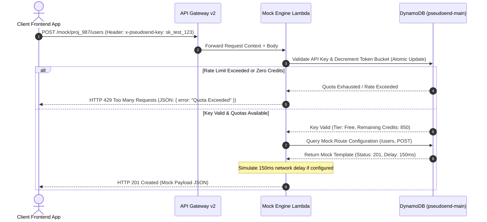

# pseudoend — Product Requirements Document (PRD 1 of 4)
## Document 1: System Architecture, Ephemeral Cloud Infrastructure & Zero-Cost IaC Blueprint

---

### Table of Contents
1. **[Client Onboarding Guide: AWS Foundations & Billing Guardrails](#1-client-onboarding-guide-aws-foundations--billing-guardrails)**
2. **[Executive Summary & System Vision](#2-executive-summary--system-vision)**
3. **[Core Architectural Principles & Zero-Idle-Cost Mandate](#3-core-architectural-principles--zero-idle-cost-mandate)**
4. **[High-Level System Topology & Sequence Diagrams](#4-high-level-system-topology--sequence-diagrams)**
5. **[Cloud Services Breakdown & Cost-Free Tier Mapping](#5-cloud-services-breakdown--cost-free-tier-mapping)**
6. **[Single-Table Database Design (DynamoDB)](#6-single-table-database-design-dynamodb)**
7. **[Ephemeral Lifecycle & Automatic Teardown Engine](#7-ephemeral-lifecycle--automatic-teardown-engine)**
8. **[Infrastructure as Code (IaC) Specifications](#8-infrastructure-as-code-iac-specifications)**
9. **[AI Model Code-Generation Prompt: Phase 1 Infrastructure](#9-ai-model-code-generation-prompt-phase-1-infrastructure)**
10. **[Client Verification Runbook: Validating Cloud Deployment](#10-client-verification-runbook-validating-cloud-deployment)**

---

## 1. Client Onboarding Guide: AWS Foundations & Billing Guardrails
> **Target Audience:** Junior Cloud Developer (approx. 1 month AWS experience)  
> **Objective:** Demystify AWS Serverless concepts, secure your account, ensure absolute \$0.00 idle operational cost, and prepare your terminal for automated deployment.

### 1.1 Key Concepts Explained Simply
- **What is "Serverless"?**  
  In traditional hosting (like EC2 or VPS), you rent a computer running 24/7. Even if nobody visits your website, you pay every second. With **AWS Serverless (Lambda & API Gateway)**, code sits dormant. When an HTTP request arrives, AWS spins up a lightweight container in 50 milliseconds, executes your code, returns the response, and terminates. **Zero requests = Zero cents billed.**
- **What is DynamoDB?**  
  A managed NoSQL key-value database. Unlike MySQL/PostgreSQL instances (RDS) that cost \$15–\$50/month just staying powered on, DynamoDB in "On-Demand" mode charges strictly per read/write. Under the AWS Free Tier, you get 25 GB of storage and 25 Read/Write Capacity Units permanently free.
- **What is Infrastructure as Code (IaC)?**  
  Instead of clicking buttons in the AWS Web Console (which leads to mistakes and forgotten running resources), we write configuration files (Terraform or AWS SAM). One command creates the entire cloud backend in 3 minutes; one command tears everything down cleanly.

### 1.2 Step-by-Step Account Setup & Zero-Dollar Safety Lock
Follow these exact steps in your AWS Console before running any code:

```
[Create AWS Account]
       │
       â–¼
[Create IAM Admin User] ────► Never use Root Account credentials!
       │
       â–¼
[Set Hard Billing Alarm] ───► CloudWatch Alarm triggers at $0.01 / $1.00
       │
       â–¼
[Install AWS CLI & Authenticate] ──► aws configure
```

1. **Never use the Root User for daily work:**
   - Log in to the AWS Management Console as Root.
   - Search for **IAM** (Identity and Access Management) -> **Users** -> **Create user**.
   - Name: `pseudoend-admin`. Check **Provide user access to the AWS Management Console**.
   - Attach policy directly: `AdministratorAccess`.
   - Once created, generate **Access Keys** (Select "CLI"). Copy your `Access Key ID` and `Secret Access Key`.
2. **Activate the Zero-Dollar AWS Budget Alarm:**
   - Search for **AWS Budgets** in the search bar.
   - Click **Create budget** -> Choose **Zero spend budget**.
   - Input your personal email address. AWS will send an urgent alert the instant charges exceed \$0.01.
3. **Configure AWS CLI on your Local Machine:**
   ```bash
   # Check if AWS CLI is installed
   aws --version

   # If not installed on macOS:
   brew install awscli
   # If on Ubuntu/Debian Linux:
   sudo apt-get install awscli -y

   # Configure your credentials
   aws configure
   # AWS Access Key ID [None]: <Paste your Access Key ID>
   # AWS Secret Access Key [None]: <Paste your Secret Access Key>
   # Default region name [None]: us-east-1
   # Default output format [None]: json
   ```
4. **Verify Connectivity:**
   ```bash
   aws sts get-caller-identity
   ```
   *Expected output:* A JSON object showing your Account ID and `pseudoend-admin` ARN.

---

## 2. Executive Summary & System Vision

### 2.1 Problem Statement
Frontend developers (web, mobile, cross-platform) spend up to 40% of their early development cycles blocked waiting for backend APIs to be designed, deployed, and stabilized. Existing mocking solutions either require local Docker containers (consuming RAM and failing mobile device access), expensive SaaS subscriptions, or complex backend staging environments that cost money even when idle.

### 2.2 Solution Overview: `pseudoend`
`pseudoend` is a **zero-idle-cost, ephemeral backend engine** designed to provision instant mock REST/JSON endpoints, echo handlers, and dynamic state machines for frontend testing. It features:
- **Instant Cloud Spin-Up:** Fully deployed via a single command into any AWS Free Tier account.
- **Zero Idle Billing:** \$0.00/month cost when idle through pure serverless architecture (Lambda, API Gateway v2, DynamoDB, S3/CloudFront).
- **Universal Technology Compatibility:** Language-agnostic HTTP/HTTPS interface consumable by React, Vue, Svelte, iOS (Swift), Android (Kotlin), Flutter, Python, or simple cURL.
- **Rigorous Anti-Abuse Guardrails:** Multi-layered rate limiters, token-bucket validation, account credit quotas, and an administrative oversight console.

---

## 3. Core Architectural Principles & Zero-Idle-Cost Mandate

1. **Strictly Pay-Per-Request (Serverless-First):** No EC2 instances, no NAT Gateways, no provisioned RDS databases, no provisioned ElastiCache Redis clusters. Every compute and storage component must scale to absolute zero.
2. **Stateless Compute:** AWS Lambda functions must remain completely stateless. Any transient mock state is persisted in DynamoDB with automated Time-To-Live (TTL) expiration.
3. **Fail-Closed Security:** In the event of rate limit exhaustion, unauthorized token usage, or credit depletion, API Gateway immediately halts execution at the edge with HTTP `429 Too Many Requests` or `403 Forbidden`, sparing Lambda execution units.
4. **Single-Table DynamoDB Architecture:** To stay strictly within the AWS 25 WCU / 25 RCU Free Tier, all application entities (Users, Projects, Routes, Rate Limits, Audit Logs) reside in a single table partitioned efficiently.
5. **Auto-Teardown Ephemerality:** Mock routes and demo endpoints carry an automatic TTL (default 24 hours, extendable up to 7 days). Expired routes are purged without developer intervention.

---

## 4. High-Level System Topology & Sequence Diagrams

### 4.1 Architecture Diagram
```
                     +-------------------------------------------------+
                     |                 Frontend Clients                |
                     |  (React, Vue, iOS, Android, Flutter, cURL)      |
                     +------------------------+------------------------+
                                              |
                                              | HTTPS / JSON
                                              v
                              +-------------------------------+
                              |    CloudFront CDN & S3        |
                              |  (Hosts pseudoend Web Portal)   |
                              +---------------+---------------+
                                              |
                     +------------------------+------------------------+
                     |                                                 |
         (Developer Portal Traffic)                         (Live Mock API Traffic)
                     v                                                 v
   +------------------------------------+             +------------------------------------+
   |   Amazon API Gateway v2 (HTTP)     |             |   Amazon API Gateway v2 (HTTP)     |
   |   Routes: /auth/*, /admin/*, etc.  |             |   Routes: /mock/{projectId}/*      |
   +-----------------+------------------+             +-----------------+------------------+
                     |                                                 |
                     v                                                 v
   +------------------------------------+             +------------------------------------+
   |    Management Lambda (Node.js/TS)  |             |    Mock Engine Lambda (Node.js/TS) |
   |  - Auth & Token Generation         |             |  - Rate-limit check via atomic DB  |
   |  - Route CRUD                      |             |  - Mock payload evaluation         |
   |  - Quota Request Approval          |             |  - Echo & Latency simulation       |
   +-----------------+------------------+             +-----------------+------------------+
                     |                                                 |
                     +------------------------+------------------------+
                                              |
                                              v
                             +---------------------------------+
                             |   Amazon DynamoDB (On-Demand)   |
                             |  Single Table (`pseudoend-main`)  |
                             |  With Native TTL Auto-Eviction  |
                             +---------------------------------+
```

### 4.2 End-to-End Request Sequence: Frontend Client Request


---

## 5. Cloud Services Breakdown & Cost-Free Tier Mapping

| AWS Service | Role in `pseudoend` | AWS Free Tier Monthly Allowance | Expected `pseudoend` Idle Cost | Safeguard Mechanism |
| :--- | :--- | :--- | :--- | :--- |
| **AWS Lambda** | Executes core mock logic and management APIs | 1,000,000 requests/month & 3.2M seconds compute | **\$0.00** | Max memory capped at 256MB; execution timeout 3s |
| **API Gateway v2 (HTTP API)** | High-speed, low-latency API router | 1,000,000 requests/month free for first 12 months (then \$1.00/M) | **\$0.00** | Throttling limits configured at route level |
| **Amazon DynamoDB** | Single-table storage for users, routes, and tokens | 25 GB storage, 25 WCU & 25 RCU permanently free | **\$0.00** | On-Demand (PAY_PER_REQUEST) with TTL auto-cleanup |
| **Amazon S3** | Static web asset hosting (HTML, JS, CSS for portal) | 5 GB standard storage | **\$0.00** | Lifecycle rule to purge deployment artifacts |
| **Amazon CloudFront** | CDN fronting S3 portal and caching static assets | 1 TB data transfer out, 10,000,000 HTTP requests free | **\$0.00** | Custom cache policies; SSL via free AWS ACM |
| **Amazon CloudWatch** | Structured logging and billing metrics | 5 GB log data ingestion free | **\$0.00** | Log retention policy set strictly to 7 days |

---

## 6. Single-Table Database Design (DynamoDB)

To prevent resource sprawl and preserve the permanent free tier, `pseudoend` uses a **Single Table Design** named `pseudoend-main`.

### 6.1 Key Schema Attributes
- **Primary Partition Key (`PK`):** String (Entity Identifier)
- **Primary Sort Key (`SK`):** String (Sub-entity or Sort sequence)
- **Global Secondary Index 1 (`GSI1PK`, `GSI1SK`):** Inverted index for reverse lookups
- **Time-To-Live Attribute (`TTL`):** Unix Epoch Timestamp (Seconds) for automatic record purging

### 6.2 Entity Data Mapping Table
| Entity Type | `PK` | `SK` | Example Attributes | TTL Enabled? |
| :--- | :--- | :--- | :--- | :--- |
| **User Account** | `USER#<userId>` | `METADATA` | `email`, `passwordHash`, `role` (user/admin), `tier` (free/pro), `creditsRemaining`, `isBanned` | No |
| **API Key** | `KEY#<apiKey>` | `USER#<userId>` | `projectId`, `createdAt`, `status` (active/revoked), `lastUsedAt` | Optional |
| **Project** | `PROJ#<projectId>` | `METADATA` | `userId`, `name`, `createdAt`, `requestCount` | Yes (if demo) |
| **Mock Route** | `PROJ#<projectId>` | `ROUTE#<method>#<path>` | `statusCode`, `responseBody`, `headers`, `latencyMs`, `isEcho` | Yes (Default 7 days) |
| **Rate Limit Bucket** | `BUCKET#<apiKey>#<window>`| `COUNTER` | `requestCount`, `windowExpiresAt` | Yes (TTL = Window + 60s)|
| **Quota Request** | `QUOTA_REQ#<reqId>` | `PENDING` or `RESOLVED`| `userId`, `requestedCredits`, `justification`, `submittedAt` | No |
| **System Config** | `CONFIG` | `GLOBAL` | `defaultFreeCredits`, `maintenanceMode`, `adminEmail` | No |

---

## 7. Ephemeral Lifecycle & Automatic Teardown Engine

To guarantee that idle projects and mock endpoints do not accumulate stale data or consume storage, `pseudoend` enforces an automated ephemerality engine:

```
[Route Created] ──► Sets DynamoDB TTL = CurrentTime + 7 Days (or custom TTL)
                         │
                         â–¼
[DynamoDB Native TTL Daemon] ──► Automatically purges expired records at zero compute cost
                         │
                         â–¼
[Teardown Script: teardown.sh] ──► Can destroy entire AWS stack in 1 command if desired
```

1. **Native DynamoDB TTL Auto-Purge:**
   - Every mock route has an attribute `ttl = Math.floor(Date.now() / 1000) + (7 * 86400)`.
   - AWS DynamoDB background scanners identify expired items and delete them automatically without charging Read or Write units.
2. **One-Command Ephemeral Destroy Script:**
   - For users testing on disposable accounts, `npm run cloud:destroy` triggers a full stack teardown, cleaning up API Gateway, Lambdas, S3 buckets, and DynamoDB tables.

---

## 8. Infrastructure as Code (IaC) Specifications

We choose **Terraform** (with an optional AWS SAM alternative) for infrastructure provisioning due to its declarative clarity and easy destruction capabilities.

### 8.1 Required Directory Hierarchy
```text
pseudoend/
├── infrastructure/
│   ├── main.tf                 # Core provider and state definitions
│   ├── apigateway.tf           # API Gateway v2 HTTP API and routes
│   ├── lambda.tf               # Lambda function definitions and permissions
│   ├── dynamodb.tf             # Single-table schema and TTL configuration
│   ├── s3_cloudfront.tf        # Web portal hosting and distribution
│   ├── outputs.tf              # Terminal output: Portal URL, Mock Base URL
│   └── variables.tf            # Configurable parameters (region, environment)
```

### 8.2 Declarative Infrastructure Definitions

#### `infrastructure/dynamodb.tf`
```hcl
resource "aws_dynamodb_table" "pseudoend_main" {
  name         = "pseudoend-main"
  billing_mode = "PAY_PER_REQUEST" # Zero idle cost
  hash_key     = "PK"
  range_key    = "SK"

  attribute {
    name = "PK"
    type = "S"
  }

  attribute {
    name = "SK"
    type = "S"
  }

  attribute {
    name = "GSI1PK"
    type = "S"
  }

  attribute {
    name = "GSI1SK"
    type = "S"
  }

  ttl {
    attribute_name = "TTL"
    enabled        = true
  }

  global_secondary_index {
    name            = "GSI1"
    hash_key        = "GSI1PK"
    range_key       = "GSI1SK"
    projection_type = "ALL"
  }

  point_in_time_recovery {
    enabled = false # Keep disabled to avoid extra costs on free accounts
  }

  tags = {
    Project     = "pseudoend"
    Environment = var.environment
  }
}
```

#### `infrastructure/apigateway.tf`
```hcl
resource "aws_apigatewayv2_api" "http_api" {
  name          = "pseudoend-http-api"
  protocol_type = "HTTP"

  cors_configuration {
    allow_origins = ["*"]
    allow_methods = ["GET", "POST", "PUT", "DELETE", "PATCH", "OPTIONS"]
    allow_headers = ["Authorization", "Content-Type", "x-pseudoend-key"]
    max_age       = 300
  }
}

resource "aws_apigatewayv2_stage" "default" {
  api_id      = aws_apigatewayv2_api.http_api.id
  name        = "$default"
  auto_deploy = true

  default_route_settings {
    throttling_burst_limit = 50
    throttling_rate_limit  = 20
  }
}
```

---

## 9. AI Model Code-Generation Prompt: Phase 1 Infrastructure

> **How to use this section:**  
> Feed the boxed prompt directly to an advanced AI coding agent (e.g., Gemini / Claude) to generate the complete, production-grade Infrastructure as Code without manual coding errors.

```markdown
### SYSTEM ROLE: Senior Principal AWS Solutions Architect & Terraform Specialist

### MISSION:
Generate the complete, production-ready Terraform IaC codebase for project "pseudoend" targeting an AWS Free Tier account with a hard requirement of $0.00 idle cost.

### ARCHITECTURAL CONSTRAINTS:
1. No EC2 instances, no VPC NAT Gateways, no provisioned RDS or Redis.
2. API Gateway v2 (HTTP API) with `$default` auto-deploying stage and CORS enabled for all origins.
3. DynamoDB table named `pseudoend-main` with:
   - Partition Key `PK` (String), Sort Key `SK` (String)
   - Billing mode: `PAY_PER_REQUEST`
   - TTL enabled on attribute `TTL`
   - Global Secondary Index `GSI1` (Hash `GSI1PK`, Range `GSI1SK`, Projection `ALL`)
4. Two Node.js 20.x AWS Lambda functions (bundled as zip files):
   - `pseudoend-management-fn`: Handles `/api/auth/*`, `/api/user/*`, `/api/admin/*`, `/api/routes/*`
   - `pseudoend-mock-engine-fn`: Handles `/mock/{proxy+}` with any HTTP method
5. Minimum IAM execution policies:
   - AWSLambdaBasicExecutionRole (CloudWatch logs limited to 7-day retention)
   - DynamoDB Query, GetItem, PutItem, UpdateItem, DeleteItem permissions strictly scoped to `pseudoend-main` table ARN.
6. S3 Bucket for static website hosting with CloudFront Distribution configured for SPA (redirect 404 to index.html).

### OUTPUT DELIVERABLES REQUIRED:
- Complete `main.tf`, `variables.tf`, `outputs.tf`, `dynamodb.tf`, `apigateway.tf`, `lambda.tf`, `s3_cloudfront.tf`.
- Fully documented code with inline comments explaining each AWS resource.
- Executable bash script `deploy.sh` that checks prerequisites, initializes Terraform, builds lambda packages, and applies infrastructure.
```

---

## 10. Client Verification Runbook: Validating Cloud Deployment
> **Target Audience:** Junior Cloud Developer  
> **Objective:** Verify everything is running correctly without spending any money.

### 10.1 Deployment Steps
1. Open your terminal in the `pseudoend` project root:
   ```bash
   cd /Users/kalyugwasi/Documents/Pseudoend
   ```
2. Run the deployment script:
   ```bash
   chmod +x deploy.sh
   ./deploy.sh
   ```
3. Watch the output. At the conclusion, Terraform will print:
   ```text
   Outputs:
   api_endpoint_url = "https://ab12cd34ef.execute-api.us-east-1.amazonaws.com"
   portal_cloudfront_url = "https://d111111abcdef8.cloudfront.net"
   ```

### 10.2 Smoke Test Validation Commands
Test your live API Gateway and Lambda connectivity using simple `curl` commands:

```bash
# 1. Healthcheck request to Management API
curl -i https://<your-api-id>.execute-api.us-east-1.amazonaws.com/api/health

# Expected response:
# HTTP/2 200
# content-type: application/json
# {"status":"healthy","service":"pseudoend","timestamp":1700000000}

# 2. Verify DynamoDB Table was created
aws dynamodb describe-table --table-name pseudoend-main --query "Table.TableStatus"
# Expected output: "ACTIVE"

# 3. Verify TTL is active on DynamoDB
aws dynamodb describe-time-to-live --table-name pseudoend-main --query "TimeToLiveDescription.TimeToLiveStatus"
# Expected output: "ENABLED"
```

### 10.3 Troubleshooting Common Errors
- **Error: `AccessDeniedException` when running Terraform:**  
  *Fix:* Your IAM user lacks permissions. Ensure `AdministratorAccess` is attached to your `pseudoend-admin` IAM user.
- **Error: `InvalidParameterValue: TTL already enabled`:**  
  *Fix:* Safe to ignore if re-running Terraform.
- **How to completely destroy the deployment to avoid any future surprises:**  
  ```bash
  cd infrastructure && terraform destroy -auto-approve
  ```
  *Result:* All cloud resources will be permanently removed in 90 seconds.

